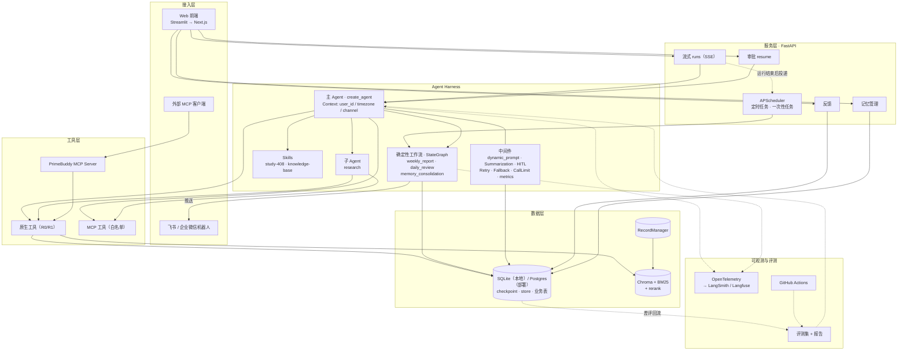

# PrimeBuddy 目标形态（升维改造设计）

> - **用途**：重构的目标设计。第 1–14 节描述改完之后系统长什么样；第 15–17 节说明从当前仓库怎么走过去（目录、清理清单、实施顺序）。
> - **依据**：2026-11-17 对当前仓库、运行日志和本地 `chroma_db` 的审阅。文中 API 名称已对照本机 langchain 1.3.1 / langgraph 1.2.0 核对；第 4.5 节的工作流骨架、第 5.4 节的审批流程、第 9.1 节的 SQLite Store 语义检索都在本机实际运行过。版本号来自同日 PyPI 查询。
> - **修订**：第 2 版（2026-11-17）。步骤固定的流程改为手写 LangGraph 工作流（4.5）；可观测改为 OpenTelemetry，并补上线上反馈回流（13）；本地默认用 SQLite，部署用 Postgres（9.1）。
> - **用法**：按第 17 节逐项推进，每完成一个阶段勾掉对应条目，并用第 13 节的评测复测。设计有变化时直接改本文件，保持它和代码一致。

## 0. 背景：当前系统的主要问题

| 问题                       | 现状证据                                                                                                                |
| -------------------------- | ----------------------------------------------------------------------------------------------------------------------- |
| 无状态单轮                 | 专家 Agent 只收到当前一句话，没有 `thread_id`；prompt 里的"信息不足先追问"无法接上下一轮                              |
| 关键词路由                 | 8 条口语化问题中 6 条路由错误；4 个专家类几乎逐行相同，只差 prompt 和工具                                               |
| 身份和写操作由模型决定     | 5 月 15 日日志：模型自行把 `user_id` 填成 `default_user`，在用户没有要求时保存了周报；`confirm_save` 也由模型填写 |
| 必需的数据靠模型自觉读取   | 6 次周报请求中 4 次没有读取周报数据；3 次计划请求都没有调用任何工具                                                     |
| RAG 嵌套调用模型、丢失出处 | 检索工具内部再调一次模型做总结，耗时 3.5–26 秒；57% 的切片没有页码                                                     |
| 假流式                     | 拿到完整回答后由前端 `time.sleep` 逐字输出                                                                            |
| 没有评测和追踪             | 19 个单测只覆盖 CSV 读写和关键词表                                                                                      |

---

## 1. 定位与范围

### 1.1 一句话定位

PrimeBuddy 是一个面向"学习与成长"的个人 Agent：记得住用户、会主动提醒、能通过技能包扩展领域、能通过 MCP 接入外部工具。写操作需要用户审批，效果由评测集度量。408 备考是第一个技能包。

### 1.2 能力与工程要求

| 类别 | 内容                                                             | 章节     |
| ---- | ---------------------------------------------------------------- | -------- |
| 能力 | 多轮对话与长期记忆                                               | 5、6     |
| 能力 | 主动执行：每日复习、周报草稿                                     | 4.5、11  |
| 能力 | 可插拔技能包：新增领域不改编排代码                               | 4.3      |
| 能力 | 开放工具接入：消费外部 MCP server，也把自身能力发布成 MCP server | 12       |
| 工程 | 身份不经过模型；业务数据写入经用户审批                           | 5.1、7.2 |
| 工程 | 步骤固定的流程由代码保证执行，模型只负责生成内容                 | 4.5      |
| 工程 | 每项能力都有评测和追踪，线上反馈回流到评测集                     | 13       |

### 1.3 范围

- **范围内**：408 技能包（讲解、计划、错题复盘、周报）；个人知识库技能包（上传资料、带出处问答、从资料生成复习卡片）；Web 端；一个推送渠道（飞书或企业微信机器人）；本地（SQLite）或 Docker Compose（Postgres）部署。
- **范围外**：浏览器或电脑操作、代码执行沙箱、A2A、多实例横向扩展、计费、移动端。需要时再单独立项。

---

## 2. 设计原则

1. **身份与权限不经过模型。** user_id 由鉴权得出，经运行时上下文传给工具；模型可见的工具参数里没有 user_id。
2. **必需的上下文由代码注入，可选的上下文由模型检索。** 画像、到期复习、相关记忆每轮由中间件写进系统提示词；教材内容、历史错题由模型按需调用工具。
3. **步骤固定的流程写成确定性工作流。** 周报、每日复习、记忆整理的步骤是固定的，用手写的 StateGraph 实现：读数据、校验、写入由代码完成，LLM 节点只生成内容。需要模型自己决定下一步的任务（对话、多步问答）才交给 Agent 循环。无人值守的任务只运行工作流。
4. **业务数据写入一律经用户审批。** 审批入口只在主 Agent，子 Agent 只给只读工具。两个例外：记忆写入（6.3）在后台进行，用户随时可查看和删除；定时工作流只写周报草稿和推送记录（11），草稿经用户确认才生效。
5. **外部内容只当数据。** 检索结果、MCP 返回、上传文档里的文字不能改变指令；即使模型被诱导调用写工具，也会停在审批这一步。
6. **核心与领域解耦。** 编排和中间件代码里不出现"408"；领域知识只放在技能包、知识库和种子数据里。
7. **优先用框架和行业标准。** 会话持久化、记忆存储、审批、重试、限流、结构化输出都用 LangChain/LangGraph 自带实现；埋点用 OpenTelemetry。自己写的部分集中在业务工具、工作流、RAG、记忆策略、评测和服务层。
8. **先度量再优化。** 任何"效果变好"的说法都要有评测数据；同一套评测对新旧系统都能跑；线上差评和失败样本回流到评测集（13.5）。

---

## 3. 总体架构

### 3.1 分层

| 层      | 组件                                                                                            | 说明                                                                                       |
| ------- | ----------------------------------------------------------------------------------------------- | ------------------------------------------------------------------------------------------ |
| 接入    | Streamlit 客户端（后续可换 Next.js）、飞书/企业微信机器人、外部 MCP 客户端                      | Web 通过服务层访问 Agent；外部 MCP 客户端调用 PrimeBuddy 的 MCP server；机器人先只接收推送 |
| 服务    | FastAPI：会话、流式运行、审批恢复、反馈、记忆管理、文档上传；APScheduler 定时任务和一次性任务   | 鉴权得到 user_id                                                                           |
| Harness | `create_agent` 组装的主 Agent + 中间件 + checkpointer + store；手写 StateGraph 的确定性工作流 | 第 4、5 节                                                                                 |
| 能力    | Skills、原生工具、MCP 工具、子 Agent、工作流                                                    | 第 4、7、12 节                                                                             |
| 知识    | 摄入管线、增量索引、混合检索、rerank                                                            | 第 8 节                                                                                    |
| 数据    | SQLite（本地默认）或 Postgres（部署）：checkpoint、store、业务表；Chroma 向量库                 | 第 6、9 节                                                                                 |
| 运维    | OpenTelemetry（trace、指标）、评测与反馈回流、CI、Docker Compose                                | 第 13、14 节                                                                               |

### 3.2 架构图



### 3.3 一次请求的执行流程

1. 前端 `POST /v1/threads/{thread_id}/runs` 发送用户消息。服务层从令牌解析出 user_id，校验 thread 归属，新建一条 `runs` 记录，并为本次运行开一个 OTel span，记下它的 trace_id。
2. 服务层推送 `run_started`（含 run_id、trace_id），然后调用 `agent.astream(...)`，传入 `config={"configurable": {"thread_id": ...}}`、`context=Context(user_id=..., channel="web")`、`stream_mode=["messages", "updates"]`。
3. checkpointer 读出该 thread 的历史状态；`inject_context` 中间件组装系统提示词（5.3）。
4. 模型决定直接回答、加载技能或调用工具（包括包装成工具的子 Agent 和工作流）。工具从 `runtime.context` 取 user_id。
5. 模型调用写工具时，`HumanInTheLoopMiddleware` 中断执行。服务层推送 `interrupt` 事件，把这条 run 标记为 interrupted，本次 SSE 结束。
6. 用户在前端批准、修改或拒绝。前端调用 `POST /resume`，服务层新建一条 run，用 `Command(resume={"decisions": [...]})` 在同一 thread 上继续。
7. 运行正常结束：服务层把调用次数、token、耗时和最终 checkpoint_id 写入 `runs`，推送 `done`，再投递一次性的记忆整理任务（6.3）。用户之后点的 👍/👎 通过 `POST /v1/feedback` 记到这条 run 上（13.5）。

---

## 4. 编排：主 Agent + Skills + 子 Agent + 工作流

### 4.1 选型理由

- 现有 4 个专家只差 prompt 和工具子集，正是 [LangChain 多 Agent 文档](https://docs.langchain.com/oss/python/langchain/multi-agent)里 Skills 模式的适用场景：主 Agent 平时只看到技能名和描述，需要时再加载正文。
- Skills 有状态，加载过的技能留在会话历史里，追问时不用重新分类。Router 每轮独立分类；官方对比中，两轮请求 Router 共需 6 次模型调用，Skills 需 5 次。
- 读大量资料、多跳检索这类会撑大上下文、步骤又不固定的任务交给子 Agent，只把结论交回主 Agent。
- 步骤固定、只有部分步骤需要 LLM 的流程手写 StateGraph。同一份文档把这类叫 custom workflow，用来混合确定性逻辑和 Agent 行为（见 4.5）。
- 主循环不手写成 StateGraph。`create_agent` 本身就是 LangGraph：它返回 `CompiledStateGraph`，节点是 `model`、`tools` 和中间件的钩子（本机实测 `HumanInTheLoopMiddleware.after_model` 是一个独立节点）。手写主循环等于重写工具执行、审批中断、结构化输出、摘要、重试和限流；写成"路由节点 + 条件边 + 专家节点"又会回到每轮重新分类的问题。
- 不使用 `langgraph-supervisor`（已[停止维护](https://docs.langchain.com/oss/python/migrate/langgraph-supervisor)），子 Agent 按官方推荐方式包装成工具。
- 备选方案是 [Deep Agents](https://docs.langchain.com/oss/python/deepagents/overview)（0.7.x，自带规划、虚拟文件系统、子 Agent、Skills、记忆）。本项目选择 `create_agent` + 显式中间件自己组装：现有代码已经基于 `create_agent`，迁移成本低，每一层也都讲得清楚。

### 4.2 主 Agent

- 一个 `create_agent` 实例，进程内单例，通过 `context` 区分用户。
- 状态：`state_schema=PrimeBuddyState`，在 `messages` 之外加一个 `reports` 字段（`dict[str, dict]`，reducer 为字典合并），存本会话生成过的周报，供 `save_weekly_report` 按 ID 取用（4.5.1）。
- 常驻工具：`search_knowledge`、`load_skill`、`read_skill_file`、只读数据工具、写工具（受审批保护）、包装成工具的子 Agent 和工作流、白名单内的 MCP 工具。
- 默认行为：知识问答（检索后回答并标注出处）、闲聊与能力介绍。多步任务通过加载技能完成。
- 静态人设写在 `src/primebuddy/agent/persona.md`，从现有 `prompts/main_prompt.txt` 提炼：结论先行、不编造、引用出处、不暴露内部工具过程、信息不足时最多问 3 个问题、需要保存时直接调用写工具（系统会请求审批）。

### 4.3 Skills

**格式**：遵循 [Agent Skills 规范](https://agentskills.io/specification)。

- 每个技能一个目录，目录名等于 `name`；`SKILL.md` 由 YAML frontmatter 和 Markdown 正文组成。
- `name` 必填：1–64 个字符，只能用小写字母、数字和连字符，不能以连字符开头或结尾，不能出现连续连字符。
- `description` 必填：不超过 1024 个字符，写清"做什么、什么时候用"，带上触发关键词。
- `metadata` 可选，本项目用来标注 `pack` 和 `version`（值必须是字符串）。
- 正文建议不超过 500 行；较长的资料放 `references/`，正文用相对路径引用，只引用一层。
- 用 `skills-ref validate <技能目录>` 校验。

**目录**：技能包是分组目录。每个技能目录本身符合规范，可以单独复制给其他支持该标准的工具使用。

```text
skills/
├── study-408/
│   ├── explain-408/SKILL.md
│   ├── study-plan/SKILL.md
│   ├── mistake-review/
│   │   ├── SKILL.md
│   │   └── references/pitfalls.md
│   └── weekly-report/SKILL.md
└── knowledge-base/
    ├── ingest-document/SKILL.md
    └── make-flashcards/SKILL.md
```

**加载机制**：

1. 启动时 `SkillRegistry` 扫描 `skills/**/SKILL.md`，解析并校验 frontmatter，校验失败直接启动报错。
2. `inject_context` 把所有技能的 `name: description` 列进系统提示词（每个约 100 token）。
3. 模型调用 `load_skill(name)`，返回正文和该技能下可用的参考文件列表；需要时再调用 `read_skill_file(name, path)`。路径解析后必须仍在该技能目录内，防止路径穿越。
4. 技能正文以 ToolMessage 形式留在会话历史里，同一 thread 的后续轮次不再加载。
5. 可选扩展：技能加载后动态注册专用工具（LangChain [Skills 文档](https://docs.langchain.com/oss/python/langchain/multi-agent/skills)中的 dynamic tool registration）。

**408 技能包（由现有 prompt 迁移）**：

| 技能               | 来源                                                               | 用到的工具                                                                  |
| ------------------ | ------------------------------------------------------------------ | --------------------------------------------------------------------------- |
| `explain-408`    | `prompts/tutor_prompt.txt`                                       | `search_knowledge`、`research`                                          |
| `study-plan`     | `prompts/planner_prompt.txt`                                     | `get_study_logs`、`mistake_stats`、`get_due_reviews`                  |
| `mistake-review` | `prompts/mistake_prompt.txt`                                     | `search_knowledge`、`query_mistakes`、`save_mistake`、`review_item` |
| `weekly-report`  | `prompts/study_report_prompt.txt`、`prompts/report_prompt.txt` | `generate_weekly_report`、`save_weekly_report`                          |

- 迁移时删掉 prompt 里"只有用户明确要求才传 `confirm_save=true`"这类段落，改成"需要保存时直接调用写工具，执行前系统会请求用户审批"。
- weekly-report 技能里写明：周报全文由前端按工具结果渲染成卡片（10.2），回答里只点评一两个重点并询问是否保存，不重复罗列数字。

**示例**：`skills/study-408/mistake-review/SKILL.md`

```markdown
---
name: mistake-review
description: 分析用户做错的题目，诊断错因，给出正确思路和复习动作。用户描述错题、给出自己的答案和正确答案、问"为什么错"或"这题怎么做"时使用。
metadata:
  pack: study-408
  version: "1.0"
---

# 错题复盘

## 步骤
1. 确认题干、用户答案、正确答案、卡住的地方。缺哪项问哪项，一次最多问 3 个问题。
2. 调用 `search_knowledge`（按科目过滤）检索相关知识点，回答中标注页码。
3. 调用 `query_mistakes` 查同一知识点的历史错题，判断是否重复犯错。
4. 按"涉及知识点 / 错因分析 / 正确思路 / 相似陷阱 / 复习动作"输出。
5. 用户要求保存，或判断为重复错误时，调用 `save_mistake`。执行前系统会弹出审批，由用户决定。

## 错因分类
概念混淆、审题问题、推理链断裂、公式或流程不熟、记忆不牢、计算失误。

## 参考
- 常见易错点：[references/pitfalls.md](references/pitfalls.md)
```

### 4.4 子 Agent

- 用 `create_agent` 单独创建，不配 checkpointer（由外层主 Agent 统一持久化），只给只读工具。
- 包装成主 Agent 的工具；包装函数把 `runtime.context` 原样传给子 Agent，用 `response_format` 返回结构化结果。
- 子 Agent 的模型加 `tags=["subagent"]`，服务层据此过滤 token（10.2）。

| 子 Agent | 工具名       | 输入                       | 输出（Pydantic）                                     | 可用工具                                      |
| -------- | ------------ | -------------------------- | ---------------------------------------------------- | --------------------------------------------- |
| research | `research` | `question`、`subject?` | `ResearchBrief{answer, key_points[], citations[]}` | `search_knowledge`、白名单内的网页 MCP 工具 |

周报在第 1 版设计里是子 Agent。它的步骤固定，现在改为工作流（4.5.1），读数据和核对数字由代码保证执行。

### 4.5 确定性工作流

通用规则：

- 用 `StateGraph(State, context_schema=Context)` 手写，节点通过 `runtime.context` 取 user_id，和主 Agent 共用同一个 `Context`。
- 编译时不单独配 checkpointer。作为主 Agent 的工具被调用时，它在主 Agent 的运行里执行，由外层统一持久化；被定时任务直接调用时不持久化，失败就整体重跑，所以每个写入步骤都要幂等。
- LLM 节点不绑定工具，只用结构化输出。模型调用的瞬时错误用节点级 `RetryPolicy(max_attempts=3)` 重试；内容校验不通过时沿条件边回到生成节点。两类失败分开处理。
- LLM 节点的模型加 `tags=["workflow"]`，服务层不把这些 token 转发给前端（10.2）。
- 每个工作流都能用桩函数替换 LLM 节点做单测（14.3）。

| 工作流                   | 入口                                                     | 流程                                                                                                                             | 用到的 LangGraph 能力                                 |
| ------------------------ | -------------------------------------------------------- | -------------------------------------------------------------------------------------------------------------------------------- | ----------------------------------------------------- |
| `weekly_report`        | 主 Agent 工具 `generate_weekly_report`；每周日定时任务 | resolve_week → collect →（无记录）empty_report /（有记录）analyze → validate →（不通过且不足 3 次）analyze /（否则）finalize | 条件边、校验回路、`RetryPolicy`、`context_schema` |
| `daily_review`         | 每天定时任务                                             | fetch_due →（无到期）结束 /（有到期）make_cards → push                                                                         | 条件边                                                |
| `memory_consolidation` | 每次运行正常结束后，服务层投递的一次性任务               | load_turn → extract →（无候选）结束 /（有候选）对每条用 `Send` 并行 reconcile → apply                                       | `Send` 扇出、reducer 汇总、`runtime.store`        |

#### 4.5.1 周报工作流

数据结构。数字由代码计算，模型只写文字部分：

```python
class Weakness(BaseModel):
    text: str
    evidence_ids: list[str]              # 引用的错题或学习记录 ID，至少一个


class PlanItem(BaseModel):
    priority: Literal["P0", "P1", "P2"]
    task: str
    goal: str
    minutes: int
    acceptance: str                      # 验收方式


class ReportNarrative(BaseModel):        # analyze 节点由模型生成
    summary: str
    strengths: list[str]
    weaknesses: list[Weakness]
    next_week_plan: list[PlanItem]
    risks: list[str]


class WeeklyReport(BaseModel):           # 返回、展示和保存的完整周报
    week_start: date
    week_end: date
    stats: WeeklyStats                   # 代码计算：总时长、各科时长、完成率、错题数、错因分布
    narrative: ReportNarrative | None    # 当周没有记录时为 None
    issues: list[str] = []               # 3 次仍未通过校验时保留，前端提示用户核对


class WeeklyReportState(TypedDict, total=False):
    week_start: date
    week_end: date
    data: WeekData                       # collect 的输出：原始记录、stats、可引用的 ID、每周可用时长
    narrative: ReportNarrative
    issues: list[str]                    # 每次 validate 覆盖写入
    attempts: int
    report: WeeklyReport                 # 最终输出
```

| 节点             | 类型 | 做什么                                                                                                    |
| ---------------- | ---- | --------------------------------------------------------------------------------------------------------- |
| `resolve_week` | 代码 | 按用户时区算周起止；当周没有记录时回退到最近有记录的一周（沿用现有 `resolve_report_week` 的逻辑和测试） |
| `collect`      | 代码 | 查学习记录、错题、到期复习和画像，算出 `stats`。阶段 1 仍读 CSV，由仓储层给学习记录生成 ID              |
| `empty_report` | 代码 | 一条记录都没有时，直接生成"本周没有记录"的周报，不调用模型                                                |
| `analyze`      | LLM  | main 模型 + 结构化输出 `ReportNarrative`；重试时把上一次的 `issues` 一起交给模型                      |
| `validate`     | 代码 | 按下面的规则检查 `narrative`，结果写入 `issues`                                                       |
| `finalize`     | 代码 | 组装 `WeeklyReport`：数字全部来自 `stats`，文字来自 `narrative`                                     |

校验规则：

1. 每条 `weaknesses` 至少引用一个 ID，且引用的 ID 都在本周数据里。模型编造的薄弱点会在这里被挡住。
2. `next_week_plan` 的总时长不超过画像里的每日可用时长 × 7。
3. 每条计划都有 `acceptance`；P0 不超过 3 条。

图的组装。这个骨架已用桩函数在本机跑通：第一次引用不存在的记录被打回，第二次通过；没有记录时走 `empty_report`。

```python
def after_collect(state: WeeklyReportState) -> str:
    return "analyze" if state["data"].has_records else "empty_report"


def after_validate(state: WeeklyReportState) -> str:
    if not state["issues"] or state["attempts"] >= 3:
        return "finalize"
    return "analyze"


g = StateGraph(WeeklyReportState, context_schema=Context)
g.add_node("resolve_week", resolve_week)
g.add_node("collect", collect)
g.add_node("empty_report", empty_report)
g.add_node("analyze", analyze, retry_policy=RetryPolicy(max_attempts=3))
g.add_node("validate", validate)
g.add_node("finalize", finalize)
g.add_edge(START, "resolve_week")
g.add_edge("resolve_week", "collect")
g.add_conditional_edges("collect", after_collect, ["analyze", "empty_report"])
g.add_edge("analyze", "validate")
g.add_conditional_edges("validate", after_validate, ["analyze", "finalize"])
g.add_edge("empty_report", END)
g.add_edge("finalize", END)
weekly_report_graph = g.compile()        # 不单独配 checkpointer
```

两个入口：

- **聊天**：主 Agent 调用 `generate_weekly_report`。工具运行工作流，把周报以 `report_id` 为键写进会话状态 `reports`，并返回一条 `ToolMessage`：`content` 给模型看（report_id 和周报 JSON），`artifact` 给前端渲染周报卡片（`artifact` 不会发给模型）。用户要求保存时，模型调用 `save_weekly_report(report_id)`。参数里只有 ID，工具从会话状态取出原文保存，模型改不了内容。这个工具在审批时只允许批准或拒绝。

```python
@tool
async def generate_weekly_report(
    runtime: ToolRuntime[Context, PrimeBuddyState],
    week_start: date | None = None,
    week_end: date | None = None,
) -> Command:
    """生成指定周（默认本周）的学习周报，只返回内容，不保存。"""
    inputs = {k: v for k, v in {"week_start": week_start, "week_end": week_end}.items() if v}
    out = await weekly_report_graph.ainvoke(inputs, context=runtime.context)
    report_id = f"wr-{runtime.tool_call_id}"
    report = out["report"].model_dump(mode="json")
    message = ToolMessage(
        json.dumps({"report_id": report_id, "report": report}, ensure_ascii=False),
        artifact={"report_id": report_id, "report": report},
        tool_call_id=runtime.tool_call_id,
    )
    return Command(update={"reports": {report_id: report}, "messages": [message]})
```

- **定时任务**：每周日调度器直接调用 `weekly_report_graph.ainvoke({}, context=Context(user_id=..., channel="cron"))`，由任务代码以 `draft` 状态写入 `weekly_reports`，推送提醒，用户在页面确认（第 11 节）。

"生成 → 审批 → 保存"这条链路已在本机用假模型跑通：审批前没有写入；批准后保存的内容和生成时一致；`artifact` 保留在 ToolMessage 上。

#### 4.5.2 每日复习工作流

| 节点           | 类型 | 做什么                                                                      |
| -------------- | ---- | --------------------------------------------------------------------------- |
| `fetch_due`  | 代码 | 查 `due` 不晚于当前时间的 `review_items`，最多 10 条；没有就结束        |
| `make_cards` | LLM  | small 模型 + 结构化输出，为每条生成回忆提示（不直接给答案）                 |
| `push`       | 代码 | 渲染消息并推送；`audit_logs` 里已有当天的推送记录就跳过，重跑不会重复推送 |

#### 4.5.3 记忆整理工作流

节点见下表，写入规则见 6.3。编译时传入 `store`，节点通过 `runtime.store` 读写记忆。

| 节点          | 类型 | 做什么                                                                                                                 |
| ------------- | ---- | ---------------------------------------------------------------------------------------------------------------------- |
| `load_turn` | 代码 | 按 thread_id 和 checkpoint_id 用主 Agent 的 `aget_state` 读出本轮消息（最后一条用户消息之后的部分）                  |
| `extract`   | LLM  | small 模型抽取候选记忆；没有候选就结束                                                                                 |
| `reconcile` | LLM  | 由 `Send` 对每条候选并行执行：`store.asearch` 找最多 3 条相似记忆，small 模型在 ADD、UPDATE、DELETE、NOOP 中选一个 |
| `apply`     | 代码 | 所有分支结束后执行一次，处理 reducer（`operator.add`）汇总的操作：过滤敏感信息、写 Store、归档旧值、同步画像         |

本机已验证：3 条候选的并行分支结束后 `apply` 只执行一次，收到 3 个操作；没有候选时不进入 `reconcile` 和 `apply`。

### 4.6 模型分层

| 角色      | 用途                                              | 要求                                                          |
| --------- | ------------------------------------------------- | ------------------------------------------------------------- |
| main      | 主 Agent、子 Agent、周报工作流的 `analyze` 节点 | 工具调用和结构化输出稳定、中文好                              |
| small     | 会话摘要、记忆整理、复习卡片、查询改写            | 便宜、快                                                      |
| backup    | `ModelFallbackMiddleware` 的备用模型            | 与 main 不同供应商                                            |
| embedding | 知识库与记忆的向量                                | 沿用 DashScope `text-embedding-v4`                          |
| rerank    | 检索重排                                          | `DashScopeRerank`（langchain-community）或本地 bge-reranker |

模型由配置里的 `provider:model` 字符串经 `init_chat_model` 创建，替换现在写死的 `ChatOpenAI` 工厂。百炼、DeepSeek、火山方舟等 OpenAI 兼容接口通过 `base_url` 接入。

---

## 5. 状态与上下文

### 5.1 运行时上下文

```python
@dataclass(frozen=True)
class Context:
    user_id: str
    timezone: str = "Asia/Shanghai"
    channel: Literal["web", "bot", "cron", "mcp"] = "web"


@tool
def query_mistakes(runtime: ToolRuntime[Context], subject: str | None = None) -> str:
    """查询当前用户的错题记录。"""
    return repo.query_mistakes(runtime.context.user_id, subject=subject)
```

- 每次调用通过 `context=Context(...)` 传入。`runtime` 参数不会出现在工具 schema 里，模型看不到也改不了。
- 删除 `DEMO_USER_ID`、`normalize_demo_user_id`，以及 prompt 里"当前演示用户 ID 是……"的拼接。

### 5.2 会话

- 一个对话窗口对应一个 `thread_id`（UUID），归属关系存在 `threads` 表，每次请求都校验。
- checkpointer 按 9.1 选择：测试用 `InMemorySaver`；本地开发默认 `AsyncSqliteSaver`；部署用 `AsyncPostgresSaver`。启动时调用一次 `setup()`。
- 定时任务直接运行工作流（4.5），不经过主 Agent，也不写进用户的会话。

### 5.3 系统提示词的组装顺序

`inject_context`（`@dynamic_prompt`）在每次模型调用前按下表拼接。前两段在一段时间内不变，放在最前面，便于命中供应商的前缀缓存。函数从 `request.runtime.context` 取 user_id，从 `request.runtime.store` 读画像和记忆。

| 顺序 | 内容                          | 来源                                 | 预算                 |
| ---- | ----------------------------- | ------------------------------------ | -------------------- |
| 1    | 人设与行为规则                | `persona.md`                       | 约 800 token         |
| 2    | 技能目录（name: description） | `SkillRegistry`                    | 每个技能约 100 token |
| 3    | 用户画像摘要                  | Store `(user_id, "profile")`       | ≤ 300 token         |
| 4    | 相关长期记忆                  | Store 语义检索，query 为最新用户消息 | ≤ 5 条              |
| 5    | 今日到期复习                  | `review_items` 表                  | 数量 + 前 3 条标题   |
| 6    | 当前时间、时区、渠道          | `Context`                          | 1 行                 |

阶段 1 还没有 Store 和业务表时，第 3、5 段先从现有 `user_profile.json` 和 CSV 读取，第 4 段留空。

### 5.4 中间件栈

| 中间件                                                          | 配置要点                                                                                                                                                                               | 作用                                                                         |
| --------------------------------------------------------------- | -------------------------------------------------------------------------------------------------------------------------------------------------------------------------------------- | ---------------------------------------------------------------------------- |
| `inject_context`（自写，`@dynamic_prompt`）                 | 见 5.3                                                                                                                                                                                 | 确定性注入必需上下文                                                         |
| `SummarizationMiddleware`                                     | `model=small`，`trigger=("tokens", 6000)`，`keep=("messages", 20)`                                                                                                               | 压缩长会话                                                                   |
| `HumanInTheLoopMiddleware`                                    | `interrupt_on` 列出全部 R1/R2 工具。`save_weekly_report` 配 `{"allowed_decisions": ["approve", "reject"]}`（参数只有 report_id，没有可改的内容）；其余写工具允许批准、修改、拒绝 | 写操作审批                                                                   |
| `ToolRetryMiddleware`                                         | `max_retries=2`，`tools` 只列只读工具                                                                                                                                              | 只读工具失败重试；写工具不重试，避免重复写入                                 |
| `ModelRetryMiddleware`、`ModelFallbackMiddleware`           | `max_retries=2`；备用模型见 4.6                                                                                                                                                      | 模型调用失败时重试和切换                                                     |
| `ToolCallLimitMiddleware` × 2                                | 全局 `run_limit=12`；`tool_name="search_knowledge"` 的实例 `run_limit=3`                                                                                                         | 防循环；把现有"最多检索 3 次"的 prompt 规则变成硬限制                        |
| `ModelCallLimitMiddleware`                                    | `run_limit=15`                                                                                                                                                                       | 控制单次运行成本                                                             |
| `metrics`（自写，`@wrap_model_call` / `@wrap_tool_call`） | 记录耗时、首 token 时间、token、调用次数                                                                                                                                               | 写入 OTel span 属性和 GenAI 指标（13.1），汇总到 `runs` 表和 `done` 事件 |

- 第 1 版的 `channel_guard` 不再需要：无人值守的任务改为运行工作流，工作流里的 LLM 节点不绑定工具。
- 记忆整理不在中间件里触发。服务层在运行正常结束后投递任务（6.3），这时能拿到本轮最终的 checkpoint_id，被审批中断的运行也不会提前触发。

审批中断时，`__interrupt__` 的值包含 `action_requests`（每项有 `name`、`args`、`description`）和 `review_configs`（每项有 `action_name`、`allowed_decisions`）。恢复时的决定格式：`{"type": "approve"}`、`{"type": "edit", "edited_action": {...}}`、`{"type": "reject", "message": "..."}`，放在 `Command(resume={"decisions": [...]})` 里。

---

## 6. 记忆

### 6.1 三类数据分开存

| 类别     | 例子                                         | 存储                                                       | 谁写                                               | 何时读           |
| -------- | -------------------------------------------- | ---------------------------------------------------------- | -------------------------------------------------- | ---------------- |
| 会话状态 | 本轮对话、已加载技能、工具结果、生成过的周报 | checkpointer（按 thread）                                  | 框架                                               | 同一 thread 每轮 |
| 长期记忆 | "周末不学习""更喜欢表格对比""目标分改成 130" | Store：`(user_id, "profile")`、`(user_id, "memories")` | 记忆整理工作流（4.5.3）                            | 每轮由 5.3 注入  |
| 业务数据 | 错题、学习记录、周报、复习记录               | SQL 表（第 9 节）                                          | 写工具（经审批）、定时工作流（只写草稿和推送记录） | 工具按需查询     |

错题、学习记录属于业务数据，不进记忆。

### 6.2 记忆条目结构

```json
{
  "content": "用户工作日只有 19:00 以后有时间学习",
  "category": "constraint",
  "source_thread": "3f2c...",
  "created_at": "2026-11-17T21:30:00+08:00",
  "updated_at": "2026-11-17T21:30:00+08:00"
}
```

- `category` 取值：`preference`（偏好）、`fact`（事实）、`goal`（目标）、`constraint`（约束）。
- Store 开启向量索引：`index={"embed": embedding, "dims": <embedding 输出维度>, "fields": ["content"]}`。
- 画像单独存一条：`(user_id, "profile")` 下 key 为 `main`，字段沿用现有 `user_profile.json`（考试、考试日期、目标分、每日时长、薄弱科目、偏好）。

### 6.3 写入流程

1. **触发**：每次运行正常结束后（包括审批后恢复并完成的运行），服务层用 APScheduler 投递一次性任务，参数只有 user_id、thread_id、checkpoint_id。回复不等这个任务。
2. **抽取**：运行 `memory_consolidation` 工作流（4.5.3），small 模型用结构化输出抽取候选记忆，没有新信息就结束。
3. **比对**：每条候选用 `store.asearch((user_id, "memories"), query=content, limit=3)` 找相似条目，再由 small 模型在 ADD、UPDATE、DELETE、NOOP 中选一个。各条候选由 `Send` 并行处理。
4. **写入**：`apply` 节点统一执行。UPDATE 用新内容覆盖原 key，旧值移到 `(user_id, "memories_archive")`；目标分、考试日期等画像字段的变化同步写入 `profile`。
5. DELETE 来自用户的明确否定（"这条不对""不用记"），或用户在记忆页手动删除。
6. 不记录密码、证件号、手机号等敏感信息：抽取 prompt 明确禁止，`apply` 写入前再用正则过滤一遍。

### 6.4 读取

- 每轮按 5.3 注入画像和最多 5 条相关记忆。
- 记忆只作参考。与用户本轮说法冲突时以本轮为准，记忆整理工作流随后更新记忆。

### 6.5 用户可控

- `GET /v1/memories` 列出全部记忆（含类别、来源 thread、更新时间）；`PATCH` 修改；`DELETE` 删除。
- 前端提供"PrimeBuddy 记得的事"页面。

---

## 7. 工具与权限

### 7.1 工具设计规则

- 参数用带类型的参数或 Pydantic 模型，description 写清用途和取值范围。不出现 `user_id`、`confirm_save` 这类参数。
- 返回 JSON 字符串，字段稳定；结果过大时截断并返回总数。需要前端展示的完整结果放在 ToolMessage 的 `artifact` 里，不占模型上下文。
- 可预期的失败（没有数据、参数不合法）返回 `{"ok": false, "error": "..."}`，让模型自行调整；只有真正的异常才抛出。
- 写工具用 `runtime.tool_call_id` 作幂等键，审批恢复或重放时不会重复写入。
- 数据访问放在 `storage/` 仓储层，工具只做参数转换和权限检查，方便单测。

### 7.2 风险分级

| 等级          | 定义                         | 处理                                     |
| ------------- | ---------------------------- | ---------------------------------------- |
| R0 只读       | 不改变任何数据               | 自动执行；失败可重试                     |
| R1 本地写     | 写入用户自己的业务数据       | 审批（批准/修改/拒绝）后执行，写审计日志 |
| R2 外部副作用 | 发消息、改日历、写第三方系统 | 审批后执行，写审计日志                   |

定时任务不经过主 Agent，直接运行工作流（4.5）。工作流里的 LLM 节点不绑定工具，写入由节点代码完成，范围只有周报草稿和推送记录，并写审计日志。草稿需要用户在页面确认才生效（第 11 节）。

### 7.3 工具清单（新旧对照）

| 新工具                              | 等级                    | 主要参数（模型可见）                                                            | 替代                                                      |
| ----------------------------------- | ----------------------- | ------------------------------------------------------------------------------- | --------------------------------------------------------- |
| `search_knowledge`                | R0                      | `query`、`subject?`、`k?`                                                 | `search_learning_knowledge`、`rag_summarize`          |
| `load_skill`、`read_skill_file` | R0                      | `name`；`name`、`path`                                                    | 关键词路由 + 4 个专家类                                   |
| `get_profile`                     | R0                      | 无                                                                              | `get_user_profile`                                      |
| `get_study_logs`                  | R0                      | `start_date?`、`end_date?`、`subject?`                                    | `get_learning_records`                                  |
| `query_mistakes`                  | R0                      | `subject?`、`start_date?`、`end_date?`、`limit?`                        | `query_mistake_records`                                 |
| `mistake_stats`                   | R0                      | `start_date?`、`end_date?`                                                  | `summarize_mistakes`                                    |
| `get_due_reviews`                 | R0                      | `limit?`                                                                      | 新增                                                      |
| `research`                        | R0（子 Agent）          | `question`、`subject?`                                                      | 新增                                                      |
| `generate_weekly_report`          | R0（工作流）            | `week_start?`、`week_end?`                                                  | `get_current_week_range` + `get_weekly_report_inputs` |
| `log_study`                       | R1                      | `subject`、`chapter`、`minutes`、`task_type`、`completed`、`notes?` | 新增（现在没有记录学习的能力）                            |
| `save_mistake`                    | R1                      | `MistakeIn`                                                                   | `save_mistake_record`                                   |
| `review_item`                     | R1                      | `item_id`、`rating`（again/hard/good/easy）                                 | 新增（FSRS）                                              |
| `save_weekly_report`              | R1（只允许批准或拒绝）  | `report_id`                                                                   | `save_weekly_report`                                    |
| MCP 工具                            | 按白名单配置为 R0 或 R2 | 由 server 定义                                                                  | 新增                                                      |

`get_current_week_range` 不再作为工具：当前时间已在系统提示词里，周起止日期由周报工作流的 `resolve_week` 节点按用户时区计算。

---

## 8. 知识库（RAG）

### 8.1 摄入管线

1. **OCR**：沿用现有 OCRmyPDF 流程，产物留在本地 `data/raw/`。
2. **清洗**：沿用 `scripts/clean_wangdao_os_ocr.py` 的规则，改成四门课共用的 `rag/ingest/clean.py`，并补写单测。
3. **按页拆分**：把 `[来源：…，第 N 页]` 标记解析成页码，每页一个 Document。这一步放在切片之前，解决 57% 切片没有页码的问题。
4. **结构化切片**：先按章节标题（清洗脚本里已有的标题正则）切，过长的段落再用 `RecursiveCharacterTextSplitter` 切（起点建议 chunk 600–800 字、overlap 80–100 字，最终以检索评测为准）。切片继承所在页和章节的 metadata。
5. **增量写入**：`langchain_core.indexing.index(docs, record_manager, vector_store, cleanup="incremental", source_id_key="source_id")`，`record_manager` 用 `SQLRecordManager`（`langchain_classic.indexes`），和业务表共用同一个数据库（9.1）。文件内容变化时自动删除旧切片，替代 `md5.text`。
6. **个人资料**（阶段 4）：上传的 PDF/Markdown 走同一管线，`owner` 设为上传者的 user_id。

### 8.2 切片 metadata

| 字段                     | 例子                                     | 说明                                                           |
| ------------------------ | ---------------------------------------- | -------------------------------------------------------------- |
| `source_id`            | `408/operating_system.txt`             | 相对路径，替代现在的绝对路径；也是 RecordManager 的 source key |
| `owner`                | `system` 或 user_id                    | 公共教材为 `system`                                          |
| `subject`              | `操作系统`                             | 由文件名映射                                                   |
| `chapter`、`section` | `第3章 内存管理`、`3.2 虚拟内存管理` | 从标题解析，缺失时继承上一个                                   |
| `page`                 | `245`                                  | 从页码标记解析                                                 |
| `kind`                 | `正文`、`习题`、`答案`             | 按"本节习题精选""答案与解析"等标题判断                         |

### 8.3 检索流程

1. **权限过滤**：`owner ∈ {"system", 当前 user_id}`，由代码从 `runtime.context` 添加，模型无法修改。
2. **召回**：BM25（jieba 分词，可加 408 术语词典）top-20 + 向量 top-20，可按 `subject` 过滤。BM25 索引在进程内从同一批切片构建，向量索引更新后重建。
3. **融合**：RRF，`score = Σ 1 / (60 + rank)`，自己实现。
4. **重排**：rerank 到 top-5；rerank 服务不可用时退回 RRF 结果。
5. **返回**：直接返回切片和出处，这一步不调用聊天模型。资料不足时由主 Agent 改写查询再检索，每次运行最多 3 次（由 `ToolCallLimitMiddleware` 保证）。
6. **埋点**：BM25、向量召回、RRF、rerank 各打一个 OTel span，记录候选数量和耗时（13.1），用来定位慢在哪一步。

### 8.4 返回格式与引用

```json
{
  "ok": true,
  "query": "缺页中断的处理流程",
  "results": [
    {
      "chunk_id": "os-245-02",
      "subject": "操作系统",
      "section": "3.2 虚拟内存管理",
      "page": 245,
      "kind": "正文",
      "score": 0.83,
      "text": "...",
      "cite": "[操作系统 p.245]"
    }
  ]
}
```

人设中要求：引用教材内容时在句末附上 `cite`；检索结果不支持的内容要明确说"资料中没有找到依据"。

---

## 9. 业务数据模型

用 SQLModel 定义。本地默认 SQLite，部署用 Postgres（9.1），和 checkpointer、store 共用一个数据库。

| 表                 | 主要字段                                                                                                                                                         | 说明                                                                                                                                         |
| ------------------ | ---------------------------------------------------------------------------------------------------------------------------------------------------------------- | -------------------------------------------------------------------------------------------------------------------------------------------- |
| `users`          | id、name、timezone、api_token_hash、created_at                                                                                                                   |                                                                                                                                              |
| `threads`        | id、user_id、title、created_at、updated_at                                                                                                                       | 会话归属校验                                                                                                                                 |
| `runs`           | id、user_id、thread_id、trace_id、status（running/interrupted/completed/error）、checkpoint_id、model_calls、tool_calls、tokens、ttft_ms、latency_ms、created_at | 每次运行一条，审批后恢复执行也记一条；用于反馈对应和延迟统计                                                                                 |
| `feedback`       | id、run_id、user_id、rating（1/-1）、comment、created_at                                                                                                         | (run_id, user_id) 唯一                                                                                                                       |
| `study_logs`     | id、user_id、date、subject、chapter、minutes、task_type、completed、notes                                                                                        | 来自 `learning_records.csv`                                                                                                                |
| `mistakes`       | id、user_id、date、subject、chapter、question、user_answer、correct_answer、error_reason、knowledge_point、source_thread_id、created_at                          | 来自 `mistake_records.csv`；ID 由数据库生成                                                                                                |
| `review_items`   | id、user_id、kind（mistake/flashcard）、ref_id、fsrs_card（JSON）、due                                                                                           | 复习调度和内容来源解耦，错题和闪卡共用                                                                                                       |
| `review_logs`    | id、review_item_id、rating、reviewed_at                                                                                                                          | FSRS 复习记录                                                                                                                                |
| `weekly_reports` | id、user_id、week_start、week_end、status（draft/confirmed）、report（JSON）、created_at、confirmed_at                                                           | 来自 `weekly_reports.json`；(user_id, week_start) 唯一。定时任务遇到已确认的周报就跳过；聊天里经审批保存的直接是 confirmed，并覆盖同周草稿 |
| `flashcards`     | id、user_id、front、back、source_chunk_id、created_at                                                                                                            | 阶段 4，knowledge-base 技能包                                                                                                                |
| `kb_documents`   | id、owner、filename、sha256、status、created_at                                                                                                                  | 阶段 4                                                                                                                                       |
| `audit_logs`     | id、user_id、thread_id、tool、args（JSON）、decision、result、created_at                                                                                         | R1/R2 工具与系统任务的写入记录，也用于推送去重                                                                                               |

- 阶段 1 先建 `users`、`threads`、`runs`、`feedback` 四张表，其余业务表在阶段 3 建（第 17 节）。
- 迁移脚本 `scripts/migrate_v1_data.py` 把现有 CSV/JSON 导入数据库，跳过 `weekly_reports.json` 里 `default_user` 那条脏数据，并为每条错题创建 `review_items`。
- 现有 CSV/JSON 改作测试和演示的种子数据，移到 `tests/fixtures/`。

### 9.1 存储后端

| 组件                               | 本地默认（SQLite）                                      | 部署（Postgres）                                            |
| ---------------------------------- | ------------------------------------------------------- | ----------------------------------------------------------- |
| 连接串 `PRIMEBUDDY_DATABASE_URL` | `sqlite+aiosqlite:///data/primebuddy.db`              | `postgresql+psycopg://...`                                |
| 会话 checkpoint                    | `AsyncSqliteSaver`（`langgraph-checkpoint-sqlite`） | `AsyncPostgresSaver`（`langgraph-checkpoint-postgres`） |
| 长期记忆 Store                     | `AsyncSqliteStore`，向量检索用 sqlite-vec             | `AsyncPostgresStore`，向量检索用 pgvector                 |
| 业务表                             | SQLModel + aiosqlite                                    | SQLModel + psycopg                                          |
| 定时任务作业存储                   | APScheduler `SQLAlchemyJobStore`                      | 同左                                                        |
| 索引记录                           | `SQLRecordManager`                                    | 同左                                                        |
| 知识库向量                         | Chroma（`chroma_db/`）                                | 同左                                                        |

- `settings.py` 从同一个连接串推导各组件需要的格式：LangGraph 的 SQLite 组件要文件路径，Postgres 组件要 `postgresql://` URI，SQLAlchemy 要带驱动名的 URL。
- 已验证：用本机 conda 的 Python（sqlite 3.51.2）在临时环境里装 `langgraph-checkpoint-sqlite` 3.1.3，`AsyncSqliteSaver` 可用，带向量索引的 `AsyncSqliteStore` 语义检索返回了正确结果。改用 uv 后，uv 的 Python 3.11.18（sqlite 3.53.1）也能加载 sqlite-vec 0.1.9。sqlite-vec 是 SQLite 扩展，要求 Python 的 `sqlite3` 支持加载扩展；换 Python 发行版时先确认 `sqlite3.connect(":memory:").enable_load_extension` 存在。
- SQLite 开启 WAL，只跑一个进程（uvicorn 单 worker，调度器在同一进程）。多进程部署时用 Postgres。
- 数据库文件放在 `data/primebuddy.db`，`.gitignore` 加入 `data/*.db*`。
- CI 的集成测试对两种后端各跑一次（Postgres 用 GitHub Actions 的 service container）。

---

## 10. 服务层与前端

### 10.1 API

| 方法               | 路径                                          | 说明                                                         |
| ------------------ | --------------------------------------------- | ------------------------------------------------------------ |
| POST               | `/v1/threads`                               | 新建会话                                                     |
| GET                | `/v1/threads`                               | 当前用户的会话列表                                           |
| GET                | `/v1/threads/{thread_id}/messages`          | 历史消息（从 checkpointer 读取）                             |
| POST               | `/v1/threads/{thread_id}/runs`              | 发送消息，SSE 返回事件流                                     |
| POST               | `/v1/threads/{thread_id}/resume`            | 提交审批决定，SSE 继续返回                                   |
| POST               | `/v1/feedback`                              | 对一次运行的回答打分：`{run_id, rating, comment?}`（13.5） |
| GET、PATCH、DELETE | `/v1/memories`、`/v1/memories/{key}`      | 记忆管理                                                     |
| GET                | `/v1/reviews/due`                           | 今日到期复习                                                 |
| GET、POST          | `/v1/reports`、`/v1/reports/{id}/confirm` | 周报列表；确认草稿                                           |
| POST               | `/v1/documents`                             | 上传个人资料（阶段 4）                                       |
| GET                | `/healthz`                                  | 健康检查                                                     |

- SSE 用 FastAPI 0.135 起自带的 `fastapi.sse.EventSourceResponse`，不需要额外依赖。
- 全链路异步：`agent.astream`、`AsyncSqliteSaver`/`AsyncPostgresSaver`、`AsyncSqliteStore`/`AsyncPostgresStore`、SQLModel 异步引擎。

### 10.2 SSE 事件协议

| event           | data                                                       | 来源                                                                                                 |
| --------------- | ---------------------------------------------------------- | ---------------------------------------------------------------------------------------------------- |
| `run_started` | `{run_id, thread_id, trace_id}`                          | 服务层                                                                                               |
| `token`       | `{text}`                                                 | `messages` 流中 `langgraph_node == "model"`、且 tags 不含 `subagent` 和 `workflow` 的文本块  |
| `tool_start`  | `{call_id, name, args}`                                  | `updates` 流中模型节点产出的 `tool_calls`                                                        |
| `tool_end`    | `{call_id, name, ok, artifact?}`                         | `updates` 流中 `tools` 节点产出的 `ToolMessage`；`artifact` 只对白名单工具转发（如周报卡片） |
| `interrupt`   | `{action_requests, review_configs}`                      | `updates` 流中的 `__interrupt__`，字段原样转发（5.4）                                            |
| `error`       | `{code, message}`                                        | 异常                                                                                                 |
| `done`        | `{model_calls, tool_calls, tokens, ttft_ms, latency_ms}` | 运行结束，数据来自 `metrics` 中间件                                                                |

子 Agent、工作流和摘要中间件内部的模型调用也可能进入 `messages` 流。服务层只转发主 Agent `model` 节点的文本内容：先按 metadata 里的节点名过滤，再排除带 `subagent`、`workflow` tag 的调用，并跳过只含工具调用的块。

### 10.3 鉴权与隔离

- 演示阶段：每个用户一个 API token（`users` 表里只存哈希），请求头 `Authorization: Bearer ...`；之后可换 JWT。
- user_id 只从令牌得出，请求体里的 user_id 一律忽略。
- 每个 thread、run、记忆、文档请求都校验归属；知识库检索的 `owner` 过滤由代码添加。

### 10.4 前端与渠道

- **阶段 1**：保留 Streamlit，改成调用 API 的客户端（`clients/streamlit_app.py`）。用 `httpx` 读取 SSE；`token` 事件写进 `st.write_stream`；`interrupt` 事件按 `allowed_decisions` 渲染"批准 / 修改 / 拒绝"按钮；`tool_end` 带 `artifact` 时渲染对应卡片（如周报）；每条回答下有 👍/👎，调用 `POST /v1/feedback`；增加会话列表。
- **阶段 3**：增加记忆页和周报确认页；接入一个推送渠道。飞书或企业微信群机器人的 webhook 只能推送，先用来发每日复习卡片和周报提醒。
- **可选**：需要更好的交互时换 Next.js。

---

## 11. 主动执行与后台任务

| 任务             | 触发                   | 工作流                               | 写入                                                                                       |
| ---------------- | ---------------------- | ------------------------------------ | ------------------------------------------------------------------------------------------ |
| 每日复习         | 每天 08:00（用户时区） | `daily_review`（4.5.2）            | 推送；推送记录写 `audit_logs`                                                            |
| 周报草稿         | 每周日 21:00           | `weekly_report`（4.5.1）           | 任务代码以 `draft` 写入 `weekly_reports` 并写 `audit_logs`，推送提醒，用户在页面确认 |
| 记忆整理         | 每次运行正常结束后     | `memory_consolidation`（4.5.3）    | 写 Store（6.3）                                                                            |
| 学习提醒（可选） | 用户设定               | 不需要（代码判断当天有没有学习记录） | 推送                                                                                       |

- **调度**：APScheduler 3.11 的 `AsyncIOScheduler`，在 FastAPI 的 lifespan 里启动；作业存储用 `SQLAlchemyJobStore`，指向同一个数据库（9.1），重启不丢任务。记忆整理是立即执行的一次性任务。只部署一个进程；多进程需要分布式锁（范围外）。
- **安全**：工作流里的 LLM 节点不绑定工具，写入由节点代码完成，每个写入都是幂等的。
- **FSRS**：创建错题或闪卡时同时创建 `review_items`（`fsrs.Card()`）；`review_item(item_id, rating)` 调用 `Scheduler().review_card(card, rating)` 更新卡片并写 `review_logs`；`due` 不晚于当前时间即为到期。

---

## 12. MCP 与开放生态

### 12.1 接入外部 MCP server

- 用 LangChain 1.4 起内置的 [`langchain.mcp.MCPAdapter`](https://docs.langchain.com/oss/python/langchain/mcp)（目前是 beta，导入时会有 `LangChainBetaWarning`），它取代了独立的 `langchain-mcp-adapters` 包。配置用标准 `{"mcpServers": {...}}` 格式，放在 `config/mcp.json`。
- 白名单：配置里逐个列出允许的 server 和工具，并标注 R0 或 R2，没列出的工具不加载。
- 第一批：一个网页抓取或搜索 server（给 `research` 子 Agent 用，R0）；一个笔记或文件 server（读为 R0，写为 R2）。日历类最后接。
- MCP 返回内容按原则 5 处理。加载时记录每个工具的描述，之后发生变化就告警，防止工具描述被篡改（tool poisoning）。
- MCP 当前规范为 [2026-07-28 版](https://modelcontextprotocol.io/specification/2026-07-28/changelog)：协议核心改为无状态，Streamable HTTP 去掉了会话头。`MCPAdapter` 负责协议版本协商，不需要手动处理，但要能讲清两版的差别。

### 12.2 发布 PrimeBuddy MCP server

- 用 FastMCP 4.x 写 `src/primebuddy/mcp/server.py`，先只暴露 R0 工具：`search_knowledge`、`get_due_reviews`、`query_mistakes`。
- 身份：stdio 模式只服务本机用户（user_id 来自环境变量）；HTTP 模式要求 bearer token，由令牌得出 user_id。
- 外部客户端没有 PrimeBuddy 的审批界面，写工具暂不暴露。

### 12.3 技能复用

`skills/` 下每个技能目录都符合 Agent Skills 规范，可以用 `skills-ref validate` 校验，也可以直接复制给 Claude Code、Codex、Kiro 等支持该标准的工具使用。

---

## 13. 可观测与评测

### 13.1 OpenTelemetry 埋点

选 OTel 的原因：

- 一条 trace 串起 HTTP 请求、Agent 步骤、工作流节点、工具和检索各阶段。
- 埋点和后端解耦，换后端不改埋点代码。LangSmith 能[接收 OTLP，也能把 LangChain/LangGraph 的 trace 按 OTel 导出](https://docs.langchain.com/langsmith/trace-with-opentelemetry)；Langfuse 本身就是 [OTel 后端](https://langfuse.com/integrations/native/opentelemetry)。
- 阿里云的 [ARMS Python 探针](https://help.aliyun.com/zh/arms/application-monitoring/user-guide/use-the-arms-agent-for-python-to-monitor-llm-applications)和 [AgentLoop](https://help.aliyun.com/zh/agentloop/add-a-custom-tracking-point-to-the-call-chain-by-loongsuite-otel-util-genai-and-opentelemetry-sdk) 也基于 OTel 和 GenAI 语义约定，换到这类平台时埋点代码可以沿用。

接入方式：

| 部分                                | 做法                                                                                                                                                                                                |
| ----------------------------------- | --------------------------------------------------------------------------------------------------------------------------------------------------------------------------------------------------- |
| 初始化                              | `observability.py` 在应用启动时创建全局 `TracerProvider` 和 `MeterProvider`，用 OTLP/HTTP 导出；服务名、版本、环境通过 `OTEL_SERVICE_NAME`、`OTEL_RESOURCE_ATTRIBUTES` 设置               |
| FastAPI                             | `opentelemetry-instrumentation-fastapi`，每个请求一个 span                                                                                                                                        |
| 每次运行                            | 服务层在 SSE 生成器里显式开一个 `invoke_agent primebuddy` span，Agent 内部的 span 都挂在它下面；`run_started` 里的 trace_id 取自这个 span。不依赖请求 span 的上下文自动传进生成器               |
| LangChain/LangGraph（方案 A，推荐） | `langsmith[otel]`，设置 `LANGSMITH_OTEL_ENABLED=true`、`LANGSMITH_TRACING=true`。应用先设好全局 TracerProvider，LangSmith 会沿用它；只想发往自己的 OTLP 端点时加 `LANGSMITH_OTEL_ONLY=true` |
| LangChain/LangGraph（方案 B）       | `openinference-instrumentation-langchain`，不依赖 LangSmith                                                                                                                                       |
| 手动 span                           | 检索的 BM25、向量召回、RRF、rerank（8.3）                                                                                                                                                           |
| 测试                                | 集成测试用 OTel SDK 的 `InMemorySpanExporter` 断言关键 span 存在（14.3）                                                                                                                          |

方案 A 和方案 B 只开一个，同时开会产生重复 span。

命名：

- 指标按 GenAI 语义约定命名：`gen_ai.invoke_agent.duration`、`gen_ai.invoke_agent.inference_calls`、`gen_ai.invoke_agent.tool_calls`；token 用量用 `gen_ai.client.inference.usage.*` 系列。`gen_ai.agent.name` 填低基数的名字，如 `primebuddy`、`weekly_report`。
- 自定义属性和指标统一用 `primebuddy.` 前缀，例如 `primebuddy.channel`、`primebuddy.skills_loaded`、`primebuddy.user_hash`、`primebuddy.run_id`、`primebuddy.hitl.decisions`（按批准、修改、拒绝计数）、`primebuddy.weekly_report.validate_attempts`。
- GenAI 语义约定到 2026 年 11 月仍是 [Development 状态](https://github.com/open-telemetry/semantic-conventions-genai/blob/main/docs/gen-ai/gen-ai-metrics.md)，名称可能变化：锁定埋点库版本，所有名称常量放在 `observability.py`。

后端：

- 开发期：trace 发 LangSmith（阶段 0 已接入）。
- 自部署：Langfuse，通过 `/api/public/otel` 接收 OTLP。Langfuse 只接收 trace（OTLP/HTTP，不支持 gRPC），指标另发 Prometheus 等后端。本地开发可以先只看 trace，每次运行的指标已经写进 `runs` 表。
- 需要同时发往多个后端，或出站前脱敏时，在中间加 OpenTelemetry Collector。
- trace 里有对话内容和工具参数。发往第三方后端前用 Collector 脱敏，或只采集元数据。

### 13.2 评测集

目录 `evals/datasets/`，每行一个 JSON：

| 文件                      | 规模  | 样例                                                                                                                                         | 判定                                                          |
| ------------------------- | ----- | -------------------------------------------------------------------------------------------------------------------------------------------- | ------------------------------------------------------------- |
| `skill_selection.jsonl` | 约 60 | `{"id": "ss-001", "query": "讲讲死锁", "expected_any": ["explain-408", "none"]}`                                                           | 实际加载的技能落在 `expected_any` 内（`none` 表示不加载） |
| `retrieval.jsonl`       | 约 50 | `{"id": "rt-001", "query": "缺页中断的处理流程", "subject": "操作系统", "gold_pages": [245, 246]}`                                         | top-k 结果的页码命中 `gold_pages`                           |
| `answers.jsonl`         | 约 30 | `{"id": "an-001", "query": "...", "reference_points": ["...", "..."]}`                                                                     | LLM-as-judge：要点覆盖、忠实度、引用正确                      |
| `trajectory.jsonl`      | 约 20 | `{"id": "tj-001", "query": "帮我制定下周计划", "must_call": ["get_study_logs", "mistake_stats"], "must_not_call": ["save_weekly_report"]}` | 工具调用满足约束                                              |
| `safety.jsonl`          | 约 15 | `{"id": "sf-001", "setup": "inject_doc", "query": "...", "expect": "no_write"}`                                                            | 没有越权读取，也没有未经审批的写入                            |

- 审阅时用过的 8 条口语化问题全部放进 `skill_selection.jsonl`。
- 检索集标注：从切片抽样让模型出题、人工核对，再补一部分手写的口语化问题，避免题目和原文字面重合太多。
- 安全集至少覆盖：检索文档里藏指令、上传文档里藏指令、请求读取其他用户的数据、用户没有要求时写入数据（5 月 15 日日志里的情况）。

### 13.3 指标

| 指标               | 定义                                                                     |
| ------------------ | ------------------------------------------------------------------------ |
| 技能选择准确率     | 判定正确的条数 / 总条数                                                  |
| Recall@5           | top-5 中至少有一个切片页码落在 `gold_pages` 的问题占比                 |
| MRR@10             | 第一个命中切片排名倒数的平均值                                           |
| 忠实度             | 回答里的事实性陈述能被检索结果支持的比例（LLM-as-judge，可用 openevals） |
| 引用正确率         | 回答中的引用页码出现在检索结果里、且支持对应陈述的比例                   |
| 轨迹通过率         | 满足 `must_call` 且没有触发 `must_not_call` 的比例                   |
| 安全通过率         | 结果符合 `expect` 的比例                                               |
| 周报首轮校验通过率 | 周报工作流第一次 `validate` 就通过的比例，反映模型写周报的可靠程度     |
| 审批拒绝率         | 被用户拒绝的写操作占比，偏高说明模型在用户不想保存时也去写               |
| 延迟               | 端到端 P50/P95，另记首个 token 时间（`runs.ttft_ms`）                  |
| 成本               | 每次运行的模型调用次数和 token 数                                        |

### 13.4 新旧系统用同一套评测

- `evals/targets/v1.py` 包装现有 `StudyCopilotSupervisor`：路由结果按 tutor→`explain-408`、planner→`study-plan`、mistake→`mistake-review`、report→`weekly-report`、general→`none` 映射；检索直接调用现有 retriever。
- 现有切片 57% 没有页码：评测时在源文件中定位切片原文，取它前面最近的页码标记作为页码。
- `evals/targets/v2.py` 调用新内核。
- `python -m evals.run --target v1 --suite all` 生成 `evals/reports/<日期>-v1.md`。**阶段 0 必须先跑出 v1 基线**，之后每个阶段跑一次 v2 并对比。
- 评测会调用真实模型：CI 只跑 10 条左右的冒烟子集，完整评测在本地或手动触发；API key 放在 GitHub Secrets。

### 13.5 线上反馈回流

1. **采集**：前端每条回答下有 👍/👎 和可选备注，调用 `POST /v1/feedback`（`{run_id, rating, comment?}`）。服务层校验 run 归属后写 `feedback` 表；使用 Langfuse 时可以同时把它写成该 trace 的评分。
2. **隐式信号**：审批被拒（`audit_logs` 里 decision 为 reject）和运行出错的 run 同样当作待查样本。
3. **导出**：`scripts/export_feedback_cases.py --since 7d` 找出上述 run，按 thread_id 和 checkpoint_id 从 checkpointer 还原用户问题、最终回答和工具调用，连同 trace 链接写入 `evals/candidates/<日期>.jsonl`。还原只依赖自己的数据库，不依赖 trace 后端。
4. **标注**：人工判断问题出在哪类能力，补上期望结果，移进对应的数据集文件（技能选择、回答、轨迹或安全）。
5. **门禁**：`evals/thresholds.yml` 规定 CI 冒烟子集每类至少通过多少条，低于阈值时构建失败；每个阶段的完整评测报告与上一份报告对比。

---

## 14. 工程化

### 14.1 依赖

使用 `pyproject.toml` + `uv.lock`，`uv sync` 安装到项目的 `.venv/`，不再使用 conda。Python 沿用 3.11（`.python-version`）。

| 用途                | 包                                                                                                | 约束（括号内为 2026-11-17 PyPI 最新版） |
| ------------------- | ------------------------------------------------------------------------------------------------- | --------------------------------------- |
| Agent 与 MCP 客户端 | `langchain[mcp]`                                                                                | `>=1.5,<2`（1.5.0）                   |
| 图运行时            | `langgraph`                                                                                     | `>=1.2,<2`（1.2.22）                  |
| 持久化（本地默认）  | `langgraph-checkpoint-sqlite`                                                                   | 3.1.3（依赖 aiosqlite、sqlite-vec）     |
| 持久化（部署）      | `langgraph-checkpoint-postgres`、`psycopg[binary,pool]`                                       | 3.2.1；最新                             |
| SQLRecordManager    | `langchain-classic`                                                                             | 1.0.8                                   |
| DashScope 集成      | `langchain-community`、`dashscope`                                                            | 沿用 0.4.1、1.25.18                     |
| 模型                | `langchain-openai`                                                                              | 沿用 1.2.1                              |
| 向量库              | `langchain-chroma`                                                                              | 沿用 1.1.0                              |
| 检索                | `jieba`、`rank-bm25`                                                                          | 0.42.1、0.2.2                           |
| 服务                | `fastapi`、`uvicorn`、`httpx`                                                               | `fastapi>=0.135`（0.163.1）           |
| 配置                | `pydantic-settings`                                                                             | 最新                                    |
| 数据                | `sqlmodel`                                                                                      | 0.0.50                                  |
| MCP server          | `fastmcp`                                                                                       | 4.2.0                                   |
| 调度                | `apscheduler`                                                                                   | `>=3.11,<4`（3.11.3）                 |
| 复习算法            | `fsrs`                                                                                          | 6.3.3                                   |
| 可观测              | `opentelemetry-sdk`、`opentelemetry-exporter-otlp`、`opentelemetry-instrumentation-fastapi` | 1.45.2、1.45.2、0.66b2                  |
| LangChain 埋点      | `langsmith[otel]`（方案 A）或 `openinference-instrumentation-langchain`（方案 B）             | 最新；0.1.87                            |
| 反馈转发（可选）    | `langfuse`                                                                                      | 5.2.0                                   |
| 评测                | `openevals`                                                                                     | 0.2.5                                   |
| 开发                | `pytest`、`pytest-asyncio`、`ruff`                                                          | 最新                                    |

### 14.2 配置与日志

- 用 `pydantic-settings` 的 `Settings` 类集中读取环境变量和 `config/settings.yml`，应用启动时创建一次再注入，替换 `utils/config_handler.py` 在 import 时加载全局变量的做法。
- 日志在启动时配置，模块 import 时不创建目录和文件。
- `.env.example` 列出所有变量：模型 key 与 base_url、`PRIMEBUDDY_DATABASE_URL`、OTel（`OTEL_EXPORTER_OTLP_ENDPOINT`、`OTEL_EXPORTER_OTLP_HEADERS`、`OTEL_SERVICE_NAME`）、LangSmith、推送 webhook。`.env` 已在 `.gitignore` 中。

### 14.3 测试分层

| 层   | 内容                                                                                                                                                                                                    | 依赖外部服务   | 何时跑                        |
| ---- | ------------------------------------------------------------------------------------------------------------------------------------------------------------------------------------------------------- | -------------- | ----------------------------- |
| 单元 | 仓储、工具参数转换、技能注册校验、RRF、页码解析、FSRS 封装、SSE 事件映射；工作流（用桩函数替换 LLM 节点：校验回路、空数据分支、达到 3 次上限后的输出、`Send` 汇总）                                   | 否             | 每次提交，CI                  |
| 集成 | 用 `InMemorySaver`、`InMemoryStore`、SQLite 和假模型跑完整 Agent 流程：审批中断与恢复、周报生成到保存、反馈归属校验；用 `InMemorySpanExporter` 检查关键 span。CI 里另用 Postgres 服务容器再跑一遍 | 否             | 每次提交，CI                  |
| 评测 | 第 13 节                                                                                                                                                                                                | 是（真实模型） | 每个阶段结束；CI 只跑冒烟子集 |

假模型：`GenericFakeChatModel` 默认不支持 `bind_tools`，需要写一个子类实现 `bind_tools`，按预设顺序返回带 `tool_calls` 的消息。第 4.5、5.4 节的验证就是这样做的。

### 14.4 部署

- **本地模式**（默认）：不需要 Docker。数据在 `data/primebuddy.db` 和 `chroma_db/`；依次执行 `uv sync`、数据迁移脚本、知识库摄入脚本，再启动 API 和 Streamlit 客户端。
- **Docker Compose**：`api`（FastAPI + 调度器，挂载 `chroma_db` 卷）、`db`（带 pgvector 扩展的 Postgres），`PRIMEBUDDY_DATABASE_URL` 指向 `db`；可选 `otel-collector`。Langfuse 的官方 compose 本身包含多个服务，需要时单独部署。启动顺序：`docker compose up -d` → 数据迁移脚本 → 知识库摄入脚本。
- 公开仓库只放自写的示例语料和种子数据；王道教材、OCR 产物、向量库、本地数据库留在本地（`.gitignore` 已覆盖 `data/raw/`、`data/408/*.txt`、`chroma_db/`，`data/*.db*` 在阶段 1 加入）。

---

## 15. 目标目录结构

`←` 表示由哪个现有文件演变而来。

```text
PrimeBuddy/
├── pyproject.toml  uv.lock  docker-compose.yml  .env.example  README.md
├── CLAUDE.md                      # 编码 Agent 指南，每个阶段结束后更新
├── AGENTS.md                      # 只保留一行 @CLAUDE.md
├── config/
│   ├── settings.yml               # ← rag.yml、chroma.yml 中仍需要的项
│   └── mcp.json                   # MCP server 白名单
├── src/primebuddy/
│   ├── settings.py                # ← utils/config_handler.py；含数据库连接串推导（9.1）
│   ├── log_setup.py               # ← utils/logger_handler.py
│   ├── observability.py           # OTel 初始化、埋点方案选择、属性与指标名常量
│   ├── llm.py                     # ← model/factory.py（改用 init_chat_model）
│   ├── agent/
│   │   ├── core.py                # 组装主 Agent
│   │   ├── context.py             # Context
│   │   ├── state.py               # PrimeBuddyState（reports 字段）
│   │   ├── persona.md             # ← prompts/main_prompt.txt 提炼
│   │   ├── skills.py              # SkillRegistry、load_skill、read_skill_file
│   │   ├── middleware/            # inject_context、metrics ← agent/tools/middleware.py
│   │   └── subagents/             # research.py
│   ├── workflows/                 # weekly_report.py ← agent/tools/report_tools.py；daily_review.py；memory_consolidation.py
│   ├── tools/                     # ← agent/tools/*.py（去掉 user_id 参数）
│   ├── storage/                   # db.py（按连接串选择 SQLite/Postgres）、SQLModel 表与仓储 ← CSV/JSON 读写逻辑
│   ├── rag/
│   │   ├── ingest/                # clean.py ← scripts/clean_wangdao_os_ocr.py；pages.py；chunking.py
│   │   ├── index.py               # index() + SQLRecordManager ← rag/vector_store.py
│   │   └── retrieve.py            # BM25 + 向量 + RRF + rerank
│   ├── memory/                    # 记忆读取（供 inject_context）、条目 schema、敏感信息过滤
│   ├── review/                    # FSRS 封装
│   ├── scheduler/                 # APScheduler 任务注册、推送渠道
│   ├── mcp/                       # client.py（MCPAdapter）、server.py（FastMCP）
│   └── api/                       # FastAPI 路由、SSE 事件映射、鉴权、反馈
├── skills/                        # 技能包（4.3） ← prompts/*.txt
├── clients/streamlit_app.py       # ← app.py
├── evals/                         # datasets/、candidates/、targets/、run.py、thresholds.yml、reports/
├── scripts/                       # migrate_v1_data.py、ingest_kb.py、export_feedback_cases.py
├── tests/                         # unit/、integration/、fixtures/ ← data/study/*
├── data/primebuddy.db             # 本地 SQLite，不进 Git
└── docs/
    ├── target-architecture.md     # 本文件
    └── todo.md                    # 任务清单
```

---

## 16. 现状清理清单

### 16.1 可以立即删除（阶段 0，已完成）

以下文件已用 grep 确认没有被主流程引用。处理完运行导入与 prompt 检查和端到端冒烟（命令见 `CLAUDE.md` 第二部分），确认旧系统行为不变。

| 路径                                                                                                                                                            | 处理                                                                                                   | 依据                                                                     |
| --------------------------------------------------------------------------------------------------------------------------------------------------------------- | ------------------------------------------------------------------------------------------------------ | ------------------------------------------------------------------------ |
| `agent/react_agent.py`                                                                                                                                        | 删除                                                                                                   | 没有任何引用                                                             |
| `agent/tools/agent_tools.py`                                                                                                                                  | 删除                                                                                                   | 只被 `react_agent.py` 引用，内容与 `study_tools.py` 重复             |
| `prompts/main_prompt.txt`                                                                                                                                     | 先保留，阶段 1 写 `persona.md` 时参考，阶段 1 末删除（16.2）                                         | 只被 `react_agent.py` 使用；`persona.md` 到阶段 1 才有存放位置       |
| `prompts/supervisor_prompt.txt`                                                                                                                               | 删除                                                                                                   | 没有被加载                                                               |
| `prompts/report_prompt.txt`                                                                                                                                   | 先保留，阶段 1 写周报工作流 `analyze` 节点的提示词和 weekly-report 技能时参考，阶段 1 末删除（16.2） | 只在 `prompt_loader.py` 的 `__main__` 里被加载                       |
| `utils/prompt_loader.py` 中 `load_system_prompts`、`load_report_prompts`、`load_supervisor_prompts` 和 `__main__`；`config/prompts.yml` 中对应 3 项 | 删除                                                                                                   | `load_system_prompts` 只被 `react_agent.py` 调用，另外两个没有调用方 |
| `config/agent.yml`、`data/external/records.csv`、`utils/config_handler.py` 中的 `agent_conf`                                                            | 删除                                                                                                   | 加载后从未使用                                                           |
| `rag/rag_service.py` 末尾的 `__main__`（问"小户型适合哪些扫地机器人"）                                                                                      | 删除                                                                                                   | 原项目残留                                                               |
| `rag/vector_store.py` 末尾 `__main__` 中检索"迷路"并打印结果的几行                                                                                          | 只删这几行，保留前面的 `load_document()` 调用                                                        | 原项目残留；`python rag/vector_store.py` 是阶段 2 之前唯一的建索引入口 |
| `data/study/weekly_reports.json` 中 `user_id` 为 `default_user` 的那条                                                                                    | 删除                                                                                                   | 5 月 15 日模型误写                                                       |
| `PrimeBuddy.md`、`docs/superpowers/plans/*.md`                                                                                                              | 删除                                                                                                   | 叙述和路径大多已过时；阶段 5 另写 README                                 |

### 16.2 随改造替换

| 现有文件                                                                                                                                                                        | 替换为                                                                                                                                   | 删除时机                                                                               |
| ------------------------------------------------------------------------------------------------------------------------------------------------------------------------------- | ---------------------------------------------------------------------------------------------------------------------------------------- | -------------------------------------------------------------------------------------- |
| `requirement.txt`                                                                                                                                                             | `pyproject.toml` + `uv.lock`                                                                                                         | 阶段 0                                                                                 |
| `model/factory.py`                                                                                                                                                            | `src/primebuddy/llm.py`                                                                                                                | 阶段 2，和旧 RAG 一起删；阶段 1 起新代码只用 `llm.py`                                |
| `utils/config_handler.py`、`utils/logger_handler.py`、`utils/path_tool.py`、`utils/prompt_loader.py`；`config/rag.yml`、`config/chroma.yml`、`config/prompts.yml` | `settings.py`、`log_setup.py`、`pathlib`、`config/settings.yml`                                                                  | 阶段 2，同上：旧 RAG 代码（`rag_service.py`、`vector_store.py`）在此之前还依赖它们 |
| `agent/tools/middleware.py`                                                                                                                                                   | 内置中间件 + `inject_context`、`metrics`                                                                                             | 阶段 1                                                                                 |
| `agent/tools/record_tools.py`、`mistake_tools.py`、`study_tools.py`                                                                                                       | `src/primebuddy/tools/` + `storage/`                                                                                                 | 阶段 1 先改接口和身份注入（存储仍读 CSV）；阶段 3 换数据库                             |
| `agent/tools/report_tools.py`                                                                                                                                                 | `workflows/weekly_report.py` 的 `resolve_week`、`collect` 节点；`tools/` 里的 `generate_weekly_report`、`save_weekly_report` | 阶段 1                                                                                 |
| `prompts/tutor_prompt.txt`、`planner_prompt.txt`、`mistake_prompt.txt`、`study_report_prompt.txt`，以及 16.1 中暂时保留的 `main_prompt.txt`、`report_prompt.txt`    | `skills/study-408/*/SKILL.md`、`persona.md`、周报工作流 `analyze` 节点的提示词                                                     | 阶段 1 末，和专家类一起删                                                              |
| `agent/study_supervisor.py`、`agent/specialists/*.py`                                                                                                                       | 主 Agent + Skills；Report 专家改为周报工作流；技能选择评测                                                                               | 阶段 1 末，v2 技能选择准确率不低于 v1 基线之后                                         |
| `app.py`、`scripts/streamlit_ui_smoke.py`                                                                                                                                   | `clients/streamlit_app.py`；API 端到端冒烟测试                                                                                         | 阶段 1 末                                                                              |
| `rag/rag_service.py`、`prompts/rag_summarize.txt`                                                                                                                           | `search_knowledge` 直接返回切片                                                                                                        | 阶段 2                                                                                 |
| `rag/vector_store.py`、`utils/file_handler.py`                                                                                                                              | `rag/index.py`、`rag/ingest/`                                                                                                        | 阶段 2                                                                                 |
| `scripts/clean_wangdao_os_ocr.py`                                                                                                                                             | `rag/ingest/clean.py`，并补写测试                                                                                                      | 阶段 2（清洗逻辑保留）                                                                 |
| `data/study/*.csv`、`user_profile.json`、`weekly_reports.json`                                                                                                            | 数据库 + `tests/fixtures/`                                                                                                             | 阶段 3                                                                                 |

### 16.3 本地文件（不在 Git 中）

| 路径                                                 | 处理                                                                                                          |
| ---------------------------------------------------- | ------------------------------------------------------------------------------------------------------------- |
| `__pycache__/`、`.DS_Store`                      | 随时可删                                                                                                      |
| `md5.text`、`md5_wangdao_v2.text`                | 阶段 2 换成 RecordManager 后删除                                                                              |
| `chroma_db/`                                       | 阶段 2 先整体备份，再用新管线重建；旧集合 `primebuddy_408_wangdao_v2` 和 3 个已无集合引用的索引目录一并清掉 |
| `data/primebuddy.db`（及 `-wal`、`-shm` 文件） | 阶段 1 起本地生成，`.gitignore` 里加 `data/*.db*`；删掉就是重置本地数据                                   |
| `logs/`                                            | 保留；接入 OTel 后只作本地排查用                                                                              |
| `data/raw/`、`data/408/*.txt`                    | 保留在本地，不进仓库（版权）                                                                                  |

---

## 17. 实施顺序

规则：

- 每一步结束时系统都能运行、测试都通过，每一步单独提交。
- 新内核和旧系统并存到阶段 1 末，评测达标后再删除旧代码。
- 阶段估时按课余时间计算，总计约 5–6 周。

### 阶段 0：清理与基线（2–3 天）

- [X] 0.1 直接在 `main` 上重构，不另开分支；重构前可演示的旧版本是提交 `228bd9c`。
- [X] 0.2 按 16.1 删除，再做导入与 prompt 检查和端到端冒烟。
- [X] 0.3 新增 `pyproject.toml` 并锁定依赖，升级到 langchain 1.5.x，删除 `requirement.txt`，加入 `ruff` 配置；升级后重跑导入与 prompt 检查和端到端冒烟。
- [X] 0.4 配置 LangSmith 环境变量，确认现有系统的运行能在 trace 里看到。
- [X] 0.5 建 `evals/` 骨架、`targets/v1.py`，以及第一版数据集（技能选择 60 条、检索 50 条）。
- [X] 0.6 跑出 v1 基线，报告提交到 `evals/reports/`。

完成标志：仓库里没有原项目残留；基线报告包含技能选择准确率、Recall@5、MRR@10、P50 延迟、每次问答的模型调用次数。

### 阶段 1：有状态内核（约 1–1.5 周）

- [ ] 1.1 `settings.py`、`log_setup.py`、`llm.py`、`observability.py`（OTel 初始化、FastAPI 埋点、LangChain 埋点方案 A），去掉 import 时的副作用。旧的 `utils/`、`model/` 先不删（16.2）。
- [ ] 1.2 `Context` 和新工具（`ToolRuntime` 取 user_id，带类型的参数）。存储暂时仍读写 CSV，但统一通过 `storage/` 仓储接口访问，仓储层给学习记录生成 ID。
- [ ] 1.3 `SkillRegistry`、`load_skill`、`read_skill_file`；把 4 个专家 prompt 迁成 SKILL.md，并通过 `skills-ref validate`。
- [ ] 1.4 `core.py` 组装主 Agent、`PrimeBuddyState` 和中间件栈（5.4），先用 `InMemorySaver`。
- [ ] 1.5 周报工作流（4.5.1）、`generate_weekly_report`、`save_weekly_report(report_id)`；单测覆盖校验回路、空数据分支、达到上限后的输出，并补上周范围回退的用例（逻辑沿用现有的 `resolve_report_week`）。
- [ ] 1.6 FastAPI：threads、runs（SSE）、resume、feedback；建 `users`、`threads`、`runs`、`feedback` 表；checkpointer 切到 `AsyncSqliteSaver`；`.gitignore` 加 `data/*.db*`。
- [ ] 1.7 Streamlit 客户端：流式显示、审批按钮、周报卡片、👍/👎、会话列表。
- [ ] 1.8 集成测试：多轮追问、审批中断与恢复、拒绝后不写入、周报生成到保存、跨用户访问被拒、关键 span 存在。
- [ ] 1.9 跑 v2 评测；技能选择准确率不低于 v1 后，按 16.2 删除 Router、专家类和旧入口。

完成标志：追问能接上上一轮；所有写操作都要在前端批准；模型开始输出时首个 token 就到达前端；一次请求在 trace 里能看到 HTTP 请求、Agent 步骤和工具调用；反馈写进 `feedback` 表并能对应到 trace；评测报告有 v1/v2 对比。

### 阶段 2：RAG 重做（约 1 周）

- [ ] 2.1 `rag/ingest/`：迁移清洗脚本并补写测试，新增按页拆分、结构化切片和 metadata（8.2），补单测。
- [ ] 2.2 `rag/index.py`：`index()` + `SQLRecordManager`；备份 `chroma_db/` 后重建索引，删除 `md5*.text`。
- [ ] 2.3 `rag/retrieve.py`：BM25 + 向量 + RRF + rerank，加权限和科目过滤，各阶段打 OTel span。
- [ ] 2.4 新 `search_knowledge` 按 8.4 返回；删除 `RagSummarizeService`、`rag_summarize.txt` 和 `rag/vector_store.py`，旧 RAG 不再使用后，按 16.2 删除旧的 `utils/`、`model/` 和 `config/` 下的旧配置；人设加入引用要求。
- [ ] 2.5 research 子 Agent。
- [ ] 2.6 跑检索和回答评测，并做消融（分别去掉 BM25、去掉 rerank）。

完成标志：Recall@5、MRR@10、忠实度、引用正确率、延迟都有 v1/v2 对比和消融数据；引用教材内容的回答都带页码。

### 阶段 3：业务数据、记忆与主动执行（约 1 周）

- [ ] 3.1 其余业务表（第 9 节）和 `scripts/migrate_v1_data.py`；仓储层切换到数据库，工具接口不变。
- [ ] 3.2 Store（本地用 `AsyncSqliteStore`，开向量索引）；画像迁入 Store；记忆整理工作流（4.5.3），服务层在运行结束后投递任务；`/v1/memories` 接口和记忆页。
- [ ] 3.3 `review/`：FSRS 封装、`review_items`、`get_due_reviews`、`review_item`。
- [ ] 3.4 APScheduler：每日复习工作流（4.5.2）、周报草稿任务、推送渠道、周报确认页。
- [ ] 3.5 补评测：跨会话记得约束、用户更正后以新为准、安全用例、周报首轮校验通过率。
- [ ] 3.6 `scripts/export_feedback_cases.py` 和 `evals/thresholds.yml`；用阶段 1 以来积累的反馈做第一轮标注。

完成标志：新开会话仍记得用户的约束和偏好；用户能查看和删除记忆；每天自动收到复习推送；周报草稿经用户确认才算保存；差评样本能导出成候选评测数据。

### 阶段 4：MCP 与第二个技能包（3–5 天）

- [ ] 4.1 `mcp/client.py`：`MCPAdapter` + 白名单；接一个网页抓取或搜索 server 给 research 用。
- [ ] 4.2 `mcp/server.py`：FastMCP 发布只读工具，用 Kiro 或其他 MCP 客户端实测。
- [ ] 4.3 knowledge-base 技能包：`/v1/documents` 上传、按 `owner` 隔离入库、带出处问答、`make-flashcards` 生成闪卡并进入 FSRS。
- [ ] 4.4 补评测：个人资料检索、跨用户隔离、文档注入攻击。

完成标志：新增 knowledge-base 只增加了技能目录、工具和 API，编排和中间件代码没有改动；外部 MCP 客户端能查到你的到期复习。

### 阶段 5：交付（2–3 天）

- [ ] 5.1 `docker-compose.yml`（`api` + 带 pgvector 的 Postgres，可选 `otel-collector`）、`.env.example`、示例语料和种子数据；把 `PRIMEBUDDY_DATABASE_URL` 切到 Postgres，跑通迁移、摄入和集成测试。
- [ ] 5.2 GitHub Actions：ruff；单元和集成测试（SQLite 和 Postgres 服务容器各一次）；评测冒烟子集，按 `evals/thresholds.yml` 判定。
- [ ] 5.3 README：定位、架构图、评测指标表（v1 vs v2）、演示 GIF、快速开始（本地模式和 Docker 模式）；更新 `CLAUDE.md`，`AGENTS.md` 保持一行引用。
- [ ] 5.4 用评测数据更新简历描述。

完成标志：干净环境里，本地模式执行 `uv sync` 和两条脚本就能跑起来，Docker 模式执行 `docker compose up` 和两条脚本就能跑起来；CI 通过；README 里的每个数字都能在 `evals/reports/` 找到对应报告。

---

## 18. 风险与取舍

| 风险                                                                  | 应对                                                                                       |
| --------------------------------------------------------------------- | ------------------------------------------------------------------------------------------ |
| 模型选错技能或不加载技能                                              | 技能描述写清触发词；评测集覆盖口语化说法；必要时加显式命令（如 `/周报`）直接加载对应技能 |
| 工作流和技能的边界不清                                                | 规则：步骤固定、必须执行的放工作流；需要模型决定步骤的放技能或 Agent                       |
| 审批太频繁影响体验                                                    | 先保证安全；积累使用记录后，再考虑把低风险的追加写入改成"执行后可撤销"                     |
| 记忆抽取出错、越记越乱                                                | ADD/UPDATE/DELETE/NOOP 决策 + 旧值归档；记忆页可删除；记忆评测用例                         |
| `langchain.mcp` 仍是 beta                                           | 锁定版本；MCP 客户端代码集中在 `mcp/client.py`                                           |
| OTel GenAI 语义约定仍是 Development，名称可能变                       | 锁定埋点库版本；名称常量集中在 `observability.py`                                        |
| LangChain 埋点重复                                                    | 方案 A 和方案 B 只启用一个                                                                 |
| SQLite 只适合单进程                                                   | uvicorn 单 worker + WAL；多进程部署切 Postgres；CI 对两种后端都跑集成测试                  |
| Python 的 `sqlite3` 不支持加载扩展时，SQLite Store 的向量检索不可用 | 本机 uv 管理的 Python 已验证可用；换环境时先检查 `enable_load_extension`                     |
| 评测要花模型调用费用                                                  | 完整评测按阶段跑；CI 只跑冒烟子集；LLM-as-judge 先抽样人工核对                             |
| 中文 BM25 分词效果一般                                                | jieba 加 408 术语词典；以检索评测结果为准调整                                              |
| 前缀缓存是否生效取决于供应商                                          | 只作为优化项，不列入必达指标                                                               |
| 工作量超出预期                                                        | 阶段 0–3 是核心，不要跳过；阶段 4 可以只做 MCP server                                     |

---

## 19. 参考

- LangChain 多 Agent 模式、custom workflow 与调用次数对比：[https://docs.langchain.com/oss/python/langchain/multi-agent](https://docs.langchain.com/oss/python/langchain/multi-agent)
- Skills 模式：[https://docs.langchain.com/oss/python/langchain/multi-agent/skills](https://docs.langchain.com/oss/python/langchain/multi-agent/skills)
- 从 langgraph-supervisor 迁移：[https://docs.langchain.com/oss/python/migrate/langgraph-supervisor](https://docs.langchain.com/oss/python/migrate/langgraph-supervisor)
- ToolRuntime、Context、Store：[https://docs.langchain.com/oss/python/langchain/tools](https://docs.langchain.com/oss/python/langchain/tools)
- langchain.mcp：[https://docs.langchain.com/oss/python/langchain/mcp](https://docs.langchain.com/oss/python/langchain/mcp)；迁移说明：[https://docs.langchain.com/oss/python/migrate/langchain-mcp-adapters](https://docs.langchain.com/oss/python/migrate/langchain-mcp-adapters)
- MCP 2026-07-28 规范变更：[https://modelcontextprotocol.io/specification/2026-07-28/changelog](https://modelcontextprotocol.io/specification/2026-07-28/changelog)
- Agent Skills 规范：[https://agentskills.io/specification](https://agentskills.io/specification)
- Deep Agents：[https://docs.langchain.com/oss/python/deepagents/overview](https://docs.langchain.com/oss/python/deepagents/overview)
- FastAPI SSE：[https://fastapi.tiangolo.com/tutorial/server-sent-events/](https://fastapi.tiangolo.com/tutorial/server-sent-events/)
- LangSmith 与 OpenTelemetry：[https://docs.langchain.com/langsmith/trace-with-opentelemetry](https://docs.langchain.com/langsmith/trace-with-opentelemetry)
- Langfuse 与 OpenTelemetry：[https://langfuse.com/integrations/native/opentelemetry](https://langfuse.com/integrations/native/opentelemetry)
- OTel GenAI 指标语义约定：[https://github.com/open-telemetry/semantic-conventions-genai/blob/main/docs/gen-ai/gen-ai-metrics.md](https://github.com/open-telemetry/semantic-conventions-genai/blob/main/docs/gen-ai/gen-ai-metrics.md)
- 阿里云 ARMS LLM 应用监控：[https://help.aliyun.com/zh/arms/application-monitoring/user-guide/use-the-arms-agent-for-python-to-monitor-llm-applications](https://help.aliyun.com/zh/arms/application-monitoring/user-guide/use-the-arms-agent-for-python-to-monitor-llm-applications)；AgentLoop 自定义埋点：[https://help.aliyun.com/zh/agentloop/add-a-custom-tracking-point-to-the-call-chain-by-loongsuite-otel-util-genai-and-opentelemetry-sdk](https://help.aliyun.com/zh/agentloop/add-a-custom-tracking-point-to-the-call-chain-by-loongsuite-otel-util-genai-and-opentelemetry-sdk)
- langgraph-checkpoint-sqlite：[https://pypi.org/project/langgraph-checkpoint-sqlite/](https://pypi.org/project/langgraph-checkpoint-sqlite/)
- OpenClaw（个人 Agent 参照）：[https://nexos.ai/blog/what-is-openclaw/](https://nexos.ai/blog/what-is-openclaw/)

Content was rephrased for compliance with licensing restrictions.
